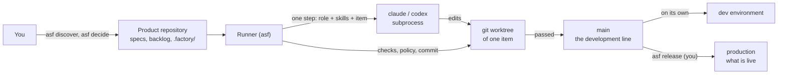
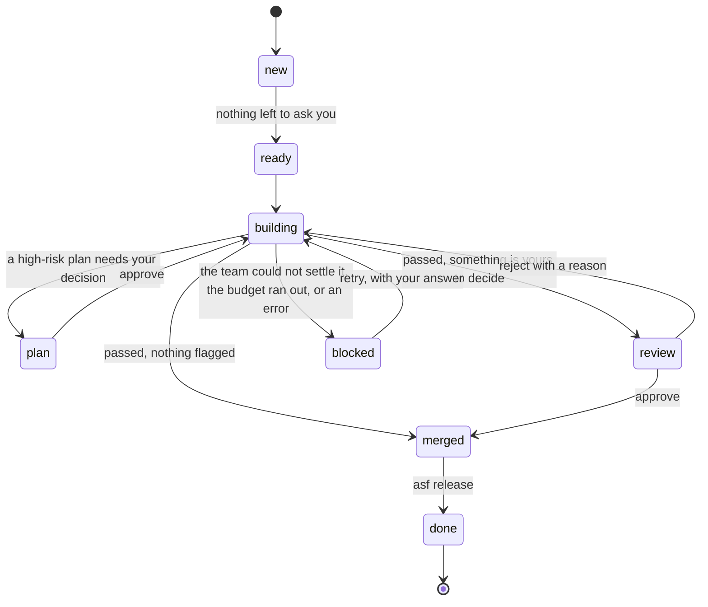
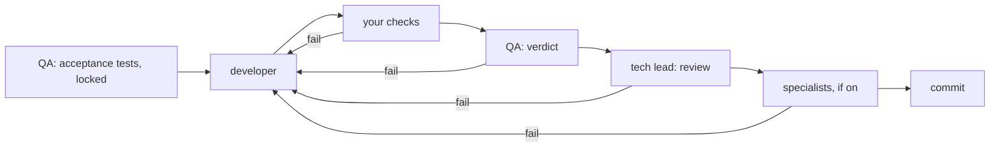

# Architecture

How the factory works inside, for whoever wants to change it or needs to trust it. To use it, start with the
[README](README.md) and [the owner's guide](docs/owners-guide.md). The reasons behind each decision are in
[docs/adr/](docs/adr/), and where it is heading in [docs/roadmap.md](docs/roadmap.md).

## The idea

A runner (`asf`, a Node.js program) plays the manager of a small team. It never calls a model API. For each step it
starts the official CLI you are signed in to (`claude` or `codex`) as a subprocess, with one role, the skills that
step needs and the artifacts of one backlog item
([ADR 0001](docs/adr/0001-run-inside-the-users-own-agent-cli.md), [0003](docs/adr/0003-runner.md)). What must hold
is checked by the runner in code, not asked of a model in a prompt.



## Two repositories

The factory and each product live apart ([ADR 0002](docs/adr/0002-repository-layout.md)).

| Factory (this repository) | Product (yours) |
| --- | --- |
| `agents/`: one brief per role | `product/`: brief, market scan, roadmap |
| `skills/`: how to do one kind of step | `specs/`: features with numbered acceptance criteria (`AC-001`) |
| `workflows/`: the steps an item goes through | `backlog/`: one file per item |
| `policies/default.yaml`: the default rules | `docs/`, and the code |
| `schemas/`: the shape of every file and answer | `.factory/project.yaml`, `.factory/policy.yaml`: its settings |
| `src/`: the runner. `evals/`: cases that measure it | `.factory/memory/context.md`: what every step should know |

Delete `.factory/` and a product is an ordinary repository. Run state (`state.json`, `runs/`, `worktrees/`,
`clarify/`, `lessons.json`) also lives under `.factory/` and is ignored by git.

## The team

| Role | When |
| --- | --- |
| **Product owner** | With you in `asf discover`: scans the market, writes the brief, specs and backlog, proposes specialists. Unattended: clarifies new items, asks only what it cannot settle, and sizes them |
| **QA** | Writes acceptance tests from the criteria before the build and locks them; after the build, judges the change against the criteria |
| **Developer** | Builds the item in its own git worktree until the checks pass |
| **Tech lead** | Plans a high-risk item; reviews every change as the senior developer who did not write it; decides lessons |
| **Security reviewer**, **UX designer** | Specialists, off until you list them under `specialists:` |
| **DevOps engineer** | CI, images, infrastructure and deploy scripts (the `infra` workflow); you run the deploy |
| **Scrum master** | After an item that needed rework: proposes a lesson, as a check rather than a longer prompt |

See [ADR 0010](docs/adr/0010-a-product-team-core-and-specialists.md) and
[0012](docs/adr/0012-the-client-decides-the-tech-lead-reviews.md).

## The life of an item

An item is a markdown file in `backlog/` with a status: `new`, `draft`, `ready` or `done`. Everything between
`ready` and `done` is run state. The board (`asf`) shows both.



`main` is the development line: an item that passes merges into it on its own, in the item's worktree, so your
checkout can be anywhere. `production` is what is live, and only your release moves it: with a `remote`,
`asf release` opens a pull request from main into production; without one it merges locally. The dev environment
deploys itself after each merge when `dev_deploy` says how
([ADR 0013](docs/adr/0013-main-is-dev-production-is-the-owners.md)).

The `feature` workflow, which builds an item:



- A failing step sends the item back to the developer with the failure as feedback, up to `max_attempts`. Then the
  item goes up the team before it reaches you: the tech lead diagnoses it and plans it again, once; after that the
  product owner splits it into smaller items, or asks you what the product should do.
- Your checks (`commands.check`: lint, build, test) run before any model reviews anything. On Claude Code the
  developer also runs them before it may finish, so a failure is fixed in the same session
  ([ADR 0008](docs/adr/0008-checks-inside-the-builders-session.md)).
- A high-risk item (`risk: high`) gets the tech lead's plan first.
- `quick` skips the tests written first, for an item the product owner sized small. A quick change that touches a
  sensitive path is thrown away and built again through `feature`. `infra` is the DevOps engineer's workflow
  ([ADR 0009](docs/adr/0009-product-overrides-and-the-quick-workflow.md),
  [0011](docs/adr/0011-devops-builds-the-pipeline-the-owner-deploys.md)).
- After `asf discover`, while the product has no checks, the tech lead chooses the stack from the brief, records it
  as an ADR in the product and sets `commands.setup` and `commands.check`. The product owner asks you about the
  product, never about the technology.

## What waits for you

The product owner's blocking questions; a plan that needs a decision of yours; a change to `owner_paths` (database
migrations by default) and, while dev deploys itself, to `deploy_paths` (CI, deploy scripts, infrastructure); a
decision a reviewer escalates (a cost, something irreversible, the agreed architecture); the product owner's
question on an item the team could not build; the release, and a deploy you run yourself. The team decides the rest
([ADR 0012](docs/adr/0012-the-client-decides-the-tech-lead-reviews.md)). Lessons are decided by the tech lead, and
you can reverse one with `asf decide L-n`.

## What the runner enforces

These hold whatever a model says, and each has a test:

- Only `ready` items are built, each in its own worktree on branch `asf/<id>`. The runner makes the commits; agents
  are denied `git push`, merging, rebasing and switching branches.
- Changes to protected paths (`.factory/`, `AGENTS.md`, `product/`, `specs/`, `backlog/`) are put back.
- Acceptance tests are locked once written. Deleting, skipping or focusing a test sends the item back.
- Added lines that look like a credential are never committed, and checks run without secrets in their environment.
- `max_attempts` and `max_tokens_per_item` stop an item that is not converging. The budget counts a token read from
  the cache as a tenth, stops the next build rather than the review of a finished one, and starts again when you
  `retry`.
- Nothing reaches production without your release.
- A product's `.factory/policy.yaml` can only tighten `policies/default.yaml`.

## The sandbox

Off by default ([ADR 0014](docs/adr/0014-the-sandbox-is-opt-in.md), which amends
[0004](docs/adr/0004-sandbox-agent-commands-and-checks.md)).

- **Off:** a developer on Claude Code may run any command that is not on `denied_commands`; reviewers can only read.
  A command an agent runs has your user's access to files and the network.
- **On:** agent commands and checks run in a sandbox with no network beyond `sandbox.network_allow` and no reading of
  `sandbox.deny_read` (your SSH keys, cloud and CLI credentials). It fails closed.

Turn it on for a product that handles keys, money or personal data, or that takes tickets written by other people:

```yaml
# .factory/policy.yaml
sandbox:
  enabled: true
```

It needs `npm install -g @anthropic-ai/sandbox-runtime` (on Linux also `bubblewrap` and `socat`) and runs on macOS,
Linux and WSL2. `ASF_SANDBOX=1` turns it on for every product on a machine.

## Platforms

| | Runner | Sandbox |
| --- | --- | --- |
| macOS | yes | yes |
| Linux, WSL2 | yes | yes |
| Windows | yes | no; use WSL2 for it |

On Windows, install Claude Code's native build and Git for Windows. Your `commands.check`, `commands.setup` and
deploy commands run in the platform's shell (`cmd.exe` on Windows), so write them to work there; `npm run …` does.
CI runs the test suite on all three.

## Tokens

Tokens are a design metric. Each step gets only its role, the skills it names and its item's artifacts. Cheap checks
run before any model review. Every step appends what it used to `.factory/runs/<date>.jsonl`, with its transcript
next to it; `asf --date <day>` reports a day by step, and `asf eval` compares versions of the factory.

## Commands

| Command | What it does |
| --- | --- |
| `asf [--json]`, `asf --date <day>` | The board, or the report of one day |
| `asf decide <id> …` | `approve`, `reject <reason>`, `retry [answer]`, `Q1 <answer>`, `accept`; `accept` or `reject` a lesson `L-n` |
| `asf show <id>` | An item's open questions, its branch and why it stopped; or a lesson |
| `asf run [--item id] [--all] [--watch]` | Build now, or keep working unattended (`--workers n`, 2 by default; `--interval s`, `--once`) |
| `asf init`, `asf discover`, `asf validate` | Set up and plan a product |
| `asf release [--dry]`, `asf deploy <env> [--yes]` | Open the release pull request into production (or merge it locally); run the deploy commands with your credentials: dev from main, other environments from production |
| `asf clarify`, `asf sync` | One round of what `--watch` does: clarify new items; sync with Jira ([ADR 0005](docs/adr/0005-tracker-through-acli-decisions-by-owner-comments.md)) |
| `asf eval` | Measure the factory on its eval cases (factory development) |

## Make it yours

In a new product's `.factory/project.yaml`, set `remote` (for example `origin`) so a release is a pull request into
production, and `dev_deploy` for a test environment that deploys itself. Without changing the factory
([ADR 0009](docs/adr/0009-product-overrides-and-the-quick-workflow.md)):

- `.factory/agents/<role>.md` and `.factory/skills/<name>/SKILL.md` add product rules to a role or a skill.
- `.factory/workflows/<name>.yaml` replaces a workflow or adds one. `workflow:` picks the default, per product, per
  item, or per ticket label `asf-<name>`.
- In `project.yaml`: `specialists:`, `paths:`, `models:` and `runtimes.roles:` (a model or a CLI per role),
  `production_branch:`, `remote:`, `dev_deploy:`, `deploy:`, `tracker:`.
- In `policy.yaml`: `owner_paths`, `deploy_paths`, `sensitive_paths`, lower budgets, more denied commands, the
  sandbox and its network allowlist.

## Where the code is

| File | What it does |
| --- | --- |
| `src/cli.ts`, `src/commands/` | The commands. `watch.ts` is the unattended loop |
| `src/engine.ts` | Runs one item through its workflow and enforces the policy |
| `src/prompt.ts`, `src/workflow.ts` | Builds each step's prompt; loads workflows |
| `src/runtimes/` | The Claude Code and Codex adapters: flags in, tokens and answers out |
| `src/checks.ts`, `src/sandbox.ts`, `src/hooks/` | Your checks, the sandbox, the checks inside a developer's session |
| `src/integrity.ts`, `src/git.ts` | Secret and test-tampering scans; worktrees and merges |
| `src/clarify.ts`, `src/retro.ts`, `src/commands/stack.ts` | The product owner's questions; lessons; the tech lead's choice of stack |
| `src/status.ts`, `src/runlog.ts`, `src/state.ts` | The board, the run log, run state |
| `src/tracker/`, `src/eval.ts` | Jira; the eval harness |

`npm test` runs everything against a fake runtime and spends no tokens. `asf eval` builds the cases in `evals/cases/`
with your CLI and scores them against hidden tests; `asf eval --reference` checks the cases with their own
solutions. Rules for changing this repository: [AGENTS.md](AGENTS.md).

## Known limits

- The sandbox is not a container, and it is off by default.
- Codex enforces access through its own sandbox only: the denied commands and the checks inside the developer's
  session apply to Claude Code.
- The size call, the tech lead's escalations and the market scan are a model's judgement, not yet measured.
  Unattended agents have no web access.
- Release pull requests need GitHub and its CLI, `gh`, signed in; merge them with a merge commit, not a squash.
- SRE is designed, not built. Jira is the only tracker, not yet checked against the real `acli`.
- End-to-end runs so far were on macOS. On Windows the runner's tests run in CI, and a full run with a real CLI has
  not been done yet.
