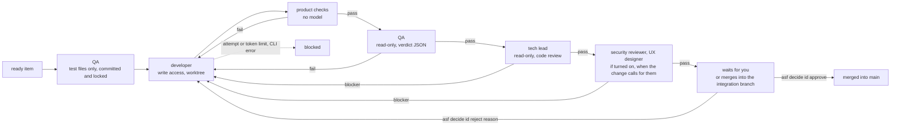

# agentic-software-factory

A local-first agentic software factory: a small team of AI agents that turns a rough idea into tested, documented
software, using your own Claude Code or Codex subscription.

You work with it the way a client works with a dev team they hired: you decide what the product does, what it costs
and when it ships; the team makes the technical calls
([ADR 0010](docs/adr/0010-a-product-team-core-and-specialists.md), [ADR 0012](docs/adr/0012-the-client-decides-the-tech-lead-reviews.md)).
You plan with the **product owner** in an interactive session, or write a rough requirement as a `new` item: the
product owner reads it, asks you only what it cannot settle itself, with options and a recommendation, and sizes it;
the item is built only once you have answered. After that, `asf run` builds the backlog unattended: **QA** turns an
item's acceptance criteria into tests, which are then locked; the **developer** implements the item in its own git
worktree until they pass; your product's own checks run; QA, read-only, judges the result against the criteria; and
the **tech lead** reviews the code as the senior developer who did not write it. The tech lead also plans a
high-risk item before it is built. Specialists are yours to turn on, and the product owner suggests them: the
**security reviewer** for a product with keys, auth or money, the **UX designer** for one with a UI. The **DevOps
engineer** builds CI, images and deploy scripts; you run the deploy, with your own credentials. Nothing reaches your
main branch until you approve it: item by item, or, with an integration branch, in batches with `asf release`. A
change waits for you on its own only when it is yours to decide: a migration, a cost, something that cannot be
undone, a change to the architecture you agreed to. A small item skips the tests written first; a quick change that
touches a sensitive path is built again with its tests first. When an item needed a second attempt or you rejected
it, the **scrum master** proposes what would stop the mistake next time, as a check rather than a longer prompt; the
tech lead decides each lesson, and you can reverse it.

> Status: 0.1, experimental. The first vertical slice works end to end with Claude Code 2.1 and codex-cli 0.147.
> Not yet published to npm.

## Why it is built this way

- **Your subscription, your machine.** The factory drives the official CLIs you are already signed in to, as
  subprocesses. It never touches a token or a credential file, and nothing runs on someone else's server.
  See [ADR 0001](docs/adr/0001-run-inside-the-users-own-agent-cli.md).
- **Spec-driven.** Brief → specs with numbered acceptance criteria → backlog items that name the criteria → tests
  named after the criteria → a verdict per criterion.
- **Tokens are a design metric.** Each step gets only its role, the skills it needs and the artifacts of its item.
  Cheap checks (lint, build, tests) run before any model review, and every step logs what it used.
- **The policy is data, not a prompt.** Protected paths are put back, denied commands are refused by the CLI, attempt
  and token limits stop runaway loops, and a product can only tighten the defaults.

## How a backlog item flows



## Requirements

- Node.js 22 or later, and git.
- Claude Code and/or Codex installed and signed in. A different vendor for QA is recommended.
- Anthropic's sandbox runtime, `npm install -g @anthropic-ai/sandbox-runtime`, and on Linux `bubblewrap` and
  `socat`. Agent commands and checks run sandboxed and refuse to run without it; see
  [ADR 0004](docs/adr/0004-sandbox-agent-commands-and-checks.md).

## Install from source

```bash
git clone https://github.com/Tech-Expansion/agentic-software-factory.git
```

```bash
cd agentic-software-factory && npm install && npm run build && npm link
```

## Quick start

```bash
asf init my-idea && cd my-idea
```

1. Edit `.factory/project.yaml`. Above all, set `commands.check` once the stack is known: it is the cheapest gate.
2. `asf discover`: the product owner interviews you, scans the alternatives your users have today (with web search
   in your CLI, every claim with its source) and writes `product/market.md`, `product/brief.md`, `specs/` and
   `backlog/`. What it finds shapes the scope: the table stakes, plus the one differentiator the hypothesis rests on.
   It sets items to `ready` only when you agree. A small product may list the criteria in each item instead of a spec.
3. `asf validate`: settings, policy, workflows and the links between backlog, specs and criteria.
4. `asf run` builds the next ready item, `asf run --all` keeps going until one blocks or none is left.
5. `asf` shows every item and every decision waiting for you, with the command to give it:
   `asf decide <id> approve`, or `asf decide <id> reject "<reason>"`.

## Commands

| Command | What it does |
| --- | --- |
| `asf` | The board: each item's column, what the team is doing (from its heartbeat, `.factory/serve.json`), every decision waiting for you oldest first with how to give it, tokens today and this week. `--json` for scripts |
| `asf decide <id> <decision>` | Every decision you make: `approve` (a plan, or a change in review: merged into the integration branch when there is one, otherwise the base branch), `reject <reason>` (the reason becomes the developer's feedback), `retry` (a blocked item), `Q1 <answer>` or `accept` (the product owner's questions; the decisions go into the item, which becomes ready), and `accept` or `reject` for a lesson `L-1`, which reverses the tech lead's decision (a check becomes a ready backlog item, a doc goes into the project memory, a factory lesson becomes a proposal, [ADR 0007](docs/adr/0007-lessons-proposed-by-retros-decided-by-the-owner.md)) |
| `asf run [--item id] [--all]` | Build ready items now |
| `asf run --watch [--workers n] [--interval s] [--once]` | Work unattended on an always-on host: sync, clarify, build up to n independent items at a time, report back. Idle rounds call no model; a usage limit pauses until the quota resets; a stop or crash resumes where it was. One process per product (`.factory/lock`) |
| `asf init [dir] [--name n]` | Create a product skeleton, `git init` it and register it in `~/.agentic-software-factory` |
| `asf discover` | Interactive planning session with the product owner, in your CLI |
| `asf validate` | Check `.factory/`, the workflows in use, the backlog and its spec and criterion links |
| `asf clarify [--item id] [--again]` | The product owner reads `new` items, asks only what it must know and sizes each; an item with nothing blocking becomes ready |
| `asf sync` | With a tracker in `project.yaml`: take in the owner's new tickets, post questions and results, apply the owner's comments (`Q1: ...`, `/accept`, `/approve`, `/reject <reason>`, `/retry`). With `tracker.digest` set to a ticket, it posts a digest of each day there and the board whenever the owner comments `/status`; see [ADR 0005](docs/adr/0005-tracker-through-acli-decisions-by-owner-comments.md) |
| `asf release [--dry]` | Merge the integration branch into the base branch, as one batch ([ADR 0006](docs/adr/0006-integration-branch-and-batch-releases.md)) |
| `asf deploy <env> [--yes]` | Show the deploy commands for `<env>` and the deploy files changed since the last deploy there; with `--yes`, run them with your own environment ([ADR 0011](docs/adr/0011-devops-builds-the-pipeline-the-owner-deploys.md)) |
| `asf show <id>` | Branch, worktree, why it stopped, what needs your attention |
| `asf report [--date d]` | Daily report: done, waiting for you, blocked, next, tokens per step |
| `asf projects` | Products registered on this machine |
| `asf eval [--case id] [--suite s] [--trials k] [--reference] [--without step]` | Run the eval cases: build cases against hidden tests, clarify cases against planted gaps; `--without` or `--workflow` measures what a step is worth (factory development) |

Older names still work: `asf status`, `serve`, `approve`, `reject`, `retry`, `answer`, `questions`, `lessons`, `lesson`.

## Repository layout

| Path | What it is |
| --- | --- |
| `agents/` | Role briefs: product owner, developer, QA, tech lead, security reviewer, UX designer, DevOps engineer, scrum master |
| `skills/` | Skills the steps load, one folder each |
| `workflows/` | Steps per kind of work: `feature.yaml`, `quick.yaml` for small changes without tests written first, `infra.yaml` for CI, images and deploy scripts |
| `policies/default.yaml` | What agents may not do, limits, paths that need a closer look, and `client_paths` that always wait for you |
| `templates/product/` | What `asf init` creates |
| `schemas/` | JSON Schema for `project.yaml`, `policy.yaml`, backlog items, verdicts and run events |
| `src/` | The runner (`asf`) and the runtime adapters |
| `docs/adr/` | Design decisions |

A product repository holds `product/`, `specs/`, `backlog/`, `docs/`, its code, and one `.factory/` folder. Delete
`.factory/` and it is an ordinary repository. See [ADR 0002](docs/adr/0002-repository-layout.md).

A product shapes its team without changing the factory ([ADR 0009](docs/adr/0009-product-overrides-and-the-quick-workflow.md)):

- `.factory/agents/<role>.md` and `.factory/skills/<name>/SKILL.md` are added to the factory's role or skill under
  "Product rules", never instead of it.
- `.factory/workflows/<name>.yaml` replaces the factory's workflow of that name, or adds one.
- `workflow:` in `project.yaml` sets the product's default; `workflow:` on an item, or a ticket label `asf-<name>`,
  picks one for that item.
- `specialists:` in `project.yaml` turns on the security reviewer or the UX designer; `paths:` names path lists a
  specialist's `when` uses, such as `ui` for the UX designer.
- `deploy:` in `project.yaml` lists the commands per environment for `asf deploy` ([ADR 0011](docs/adr/0011-devops-builds-the-pipeline-the-owner-deploys.md)).

## Known limits

- Agent commands and checks run in a sandbox with no credentials and network only to package registries, not in a
  container. Codex has no network but can read what its user can; the secret scan before each commit is the
  backstop there. See [ADR 0004](docs/adr/0004-sandbox-agent-commands-and-checks.md).
- Codex enforces access through its sandbox only; the denied-commands list applies to Claude Code.
- The product owner's size call (small or normal), what the tech lead escalates to you, and the market scan are a
  model's judgement and not yet measured. The scan is only as good as the web search in your CLI; unattended agents
  have no web access at all. SRE (checks after a
  deploy, alerts turned into bugs) is designed, not built. Jira is the only external tracker.
- On Claude Code the developer runs the checks itself before it may finish (a Stop hook, [ADR 0008](docs/adr/0008-checks-inside-the-builders-session.md)); Codex has no such hook and relies on the runner's attempts.
- A developer call carries a fixed overhead of about 30k input tokens per turn (the CLI's own system prompt and tools),
  most of it served from cache.

## Development

```bash
npm test
```

Tests use a fake runtime and spend no tokens.

How well the factory works is measured, not guessed: see the [roadmap](docs/roadmap.md). Each case in `evals/cases/`
is a small product with a backlog and acceptance tests the agents never see. Cases are in one of two suites:
`regression` cases should stay near 100% and catch a version that got worse, `capability` cases start low and show
whether a change lets the factory do more. `asf eval` builds every case with your CLI and reports the delivery rate
with its 95% interval, hard-gate breaches, attempts and tokens; with `--trials k` each case runs k times and the
report adds pass^k (delivered in every trial) and pass@k (in at least one). Agent transcripts are kept next to the
results file for error analysis. `asf eval --reference` builds the cases with their own solutions instead, to check
the cases themselves; CI runs it.

```bash
node dist/cli.js eval --trials 3
```

## License

[MIT](LICENSE)
