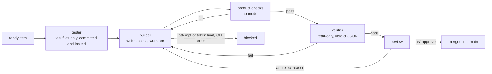

# agentic-software-factory

A local-first agentic software factory: a small team of AI agents that turns a rough idea into tested, documented
software, using your own Claude Code or Codex subscription.

You plan with the **planner** in an interactive session, or write a rough requirement as a `new` item: the
**analyst** reads it and asks you only what it cannot settle itself, with options and a recommendation, and the item
is built only once you have answered. After that, `asf run` builds the backlog unattended: the
**tester** turns an item's acceptance criteria into tests, which are then locked; the **builder** implements the item
in its own git worktree until they pass; your product's own checks run; and a read-only **verifier** judges the result
against the item's acceptance criteria. Nothing reaches your main branch until you run
`asf approve`.

> Status: 0.1, experimental. The first vertical slice works end to end with Claude Code 2.1 and codex-cli 0.147.
> Not yet published to npm.

## Why it is built this way

- **Your subscription, your machine.** The factory drives the official CLIs you are already signed in to, as
  subprocesses. It never touches a token or a credential file, and nothing runs on someone else's server.
  See [ADR 0001](docs/adr/0001-run-inside-the-users-own-agent-cli.md).
- **Spec-driven.** Brief → specs with numbered acceptance criteria → backlog items that name the criteria → tests
  named after the criteria → a verdict per criterion.
- **Tokens are a design metric.** Each step gets only its role, the skills it needs and the artifacts of its item.
  Cheap checks (lint, build, tests) run before any model review, and every step logs what it used.
- **The policy is data, not a prompt.** Protected paths are put back, denied commands are refused by the CLI, attempt
  and token limits stop runaway loops, and a product can only tighten the defaults.

## How a backlog item flows



## Requirements

- Node.js 22 or later, and git.
- Claude Code and/or Codex installed and signed in. A different vendor as verifier is recommended.
- Anthropic's sandbox runtime, `npm install -g @anthropic-ai/sandbox-runtime`, and on Linux `bubblewrap` and
  `socat`. Agent commands and checks run sandboxed and refuse to run without it; see
  [ADR 0004](docs/adr/0004-sandbox-agent-commands-and-checks.md).

## Install from source

```bash
git clone https://github.com/Tech-Expansion/agentic-software-factory.git
```

```bash
cd agentic-software-factory && npm install && npm run build && npm link
```

## Quick start

```bash
asf init my-idea && cd my-idea
```

1. Edit `.factory/project.yaml`. Above all, set `commands.check` once the stack is known: it is the cheapest gate.
2. `asf discover`: the planner interviews you and writes `product/brief.md`, `specs/` and `backlog/`. It sets items to
   `ready` only when you agree.
3. `asf validate`: settings, policy and the links between backlog, specs and criteria.
4. `asf run` builds the next ready item, `asf run --all` keeps going until one blocks or none is left.
5. `asf report`, `asf show <id>`, then `asf approve <id>` or `asf reject <id> "<reason>"`.

## Commands

| Command | What it does |
| --- | --- |
| `asf init [dir] [--name n]` | Create a product skeleton, `git init` it and register it in `~/.agentic-software-factory` |
| `asf discover` | Interactive planning session with the planner, in your CLI |
| `asf validate` | Check `.factory/`, the backlog and its spec and criterion links |
| `asf clarify [--item id] [--again]` | The analyst reads `new` items and asks only what it must know; an item with nothing blocking becomes ready |
| `asf questions` | Open questions, with options and the team's recommendation |
| `asf answer <id> <Q> <answer>` / `asf answer <id> --accept` | Answer a question, or take every recommendation left; the decisions go into the item, which becomes ready |
| `asf run [--item id] [--all]` | Build ready items unattended |
| `asf show <id>` | Branch, worktree, why it stopped, what needs your attention |
| `asf approve <id>` | Mark the item done and merge its branch (the only way code reaches the base branch) |
| `asf reject <id> <reason>` | Send it back; the reason becomes the builder's feedback |
| `asf retry <id>` | Let a blocked item run again |
| `asf report [--date d]` | Daily report: done, waiting for you, blocked, next, tokens per step |
| `asf projects` | Products registered on this machine |
| `asf eval [--case id] [--suite s] [--trials k] [--reference]` | Run the eval cases: build cases against hidden tests, clarify cases against planted gaps (factory development) |

## Repository layout

| Path | What it is |
| --- | --- |
| `agents/` | Role briefs: planner, analyst, tester, builder, verifier |
| `skills/` | Skills the steps load, one folder each |
| `workflows/` | Steps per kind of work (`feature.yaml`) |
| `policies/default.yaml` | What agents may not do, limits, paths that need your attention |
| `templates/product/` | What `asf init` creates |
| `schemas/` | JSON Schema for `project.yaml`, `policy.yaml`, backlog items, verdicts and run events |
| `src/` | The runner (`asf`) and the runtime adapters |
| `docs/adr/` | Design decisions |

A product repository holds `product/`, `specs/`, `backlog/`, `docs/`, its code, and one `.factory/` folder. Delete
`.factory/` and it is an ordinary repository. See [ADR 0002](docs/adr/0002-repository-layout.md).

## Known limits

- Agent commands and checks run in a sandbox with no credentials and network only to package registries, not in a
  container. Codex has no network but can read what its user can; the secret scan before each commit is the
  backstop there. See [ADR 0004](docs/adr/0004-sandbox-agent-commands-and-checks.md).
- Codex enforces access through its sandbox only; the denied-commands list applies to Claude Code.
- Only the feature workflow exists. Learning from the run log, deployment and external trackers are not built yet.
- A builder call carries a fixed overhead of about 30k input tokens per turn (the CLI's own system prompt and tools),
  most of it served from cache.

## Development

```bash
npm test
```

Tests use a fake runtime and spend no tokens.

How well the factory works is measured, not guessed: see the [roadmap](docs/roadmap.md). Each case in `evals/cases/`
is a small product with a backlog and acceptance tests the agents never see. Cases are in one of two suites:
`regression` cases should stay near 100% and catch a version that got worse, `capability` cases start low and show
whether a change lets the factory do more. `asf eval` builds every case with your CLI and reports the delivery rate
with its 95% interval, hard-gate breaches, attempts and tokens; with `--trials k` each case runs k times and the
report adds pass^k (delivered in every trial) and pass@k (in at least one). Agent transcripts are kept next to the
results file for error analysis. `asf eval --reference` builds the cases with their own solutions instead, to check
the cases themselves; CI runs it.

```bash
node dist/cli.js eval --trials 3
```

## License

[MIT](LICENSE)
