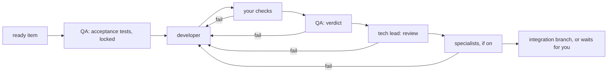

# agentic-software-factory

A local-first software team of AI agents. It turns a rough idea into tested, documented software, using your own
Claude Code or Codex subscription.

You are its owner, the way a client is to a team they hired: you decide what the product does, what it costs and when
it ships, and the team makes the technical calls.

> Status: 0.1, experimental. Works end to end with Claude Code 2.1 and codex-cli 0.147. Not yet on npm.

## The team

| Role | When |
| --- | --- |
| **Product owner** | With you in `asf discover`: scans the market, writes the brief, specs and backlog, and proposes specialists. Unattended: clarifies new items, asks only what it cannot settle, and sizes them |
| **QA** | Writes acceptance tests from the criteria before the build and locks them; after the build, judges the change against the criteria |
| **Developer** | Builds the item in its own git worktree until the checks pass |
| **Tech lead** | Plans a high-risk item; reviews every change as the senior developer who did not write it; decides lessons |
| **Security reviewer**, **UX designer** | Specialists, off until you turn them on in `specialists:` |
| **DevOps engineer** | CI, images, infrastructure and deploy scripts (the `infra` workflow); you run the deploy |
| **Scrum master** | After an item that needed rework: proposes a lesson, as a check rather than a longer prompt |



A small item skips the tests written first; one that touches a sensitive path is built again with them. What waits
for you: the product owner's questions, a migration (`owner_paths`), a decision a reviewer escalates (a cost,
something irreversible, the agreed architecture), the release and the deploy. The team decides the rest, and you can
reverse a lesson with `asf decide L-n`. See [ADR 0012](docs/adr/0012-the-client-decides-the-tech-lead-reviews.md).

## Why it is built this way

- **Your subscription, your machine.** It drives the official CLIs you are signed in to, as subprocesses, and never
  touches a credential ([ADR 0001](docs/adr/0001-run-inside-the-users-own-agent-cli.md)).
- **Spec-driven.** Criteria are numbered; tests and verdicts are named after them.
- **Tokens are a design metric.** Each step gets only its role, its skills and its item's artifacts; cheap checks run
  before any model review; every step logs what it used.
- **Policy is code, not a prompt.** Protected paths are put back, denied commands refused, budgets enforced, and a
  product can only tighten the defaults. Agents run sandboxed ([ADR 0004](docs/adr/0004-sandbox-agent-commands-and-checks.md)).

## Install

Node.js 22+, git, Claude Code and/or Codex signed in, and the sandbox runtime
(`npm install -g @anthropic-ai/sandbox-runtime`; on Linux also `bubblewrap` and `socat`).

```bash
git clone https://github.com/Tech-Expansion/agentic-software-factory.git
```

```bash
cd agentic-software-factory && npm install && npm run build && npm link
```

## Use

```bash
asf init my-idea && cd my-idea
```

1. In `.factory/project.yaml`, set `integration_branch: integration` so passing items merge on their own and you
   release in batches.
2. `asf discover`: plan with the product owner. Items become `ready` only when you agree.
3. Set `commands.check` (lint, build, test) once the stack is known, then `asf validate`.
4. `asf run --watch` keeps the team working; `asf` shows the board and every decision waiting for you, with the
   command that gives it.

| Command | What it does |
| --- | --- |
| `asf [--json]`, `asf --date <day>` | The board, or the report of one day |
| `asf decide <id> …` | `approve`, `reject <reason>`, `retry`, `Q1 <answer>`, `accept`; `accept` or `reject` a lesson `L-n` |
| `asf show <id>` | An item's open questions, its branch and why it stopped; or a lesson |
| `asf run [--item id] [--all] [--watch]` | Build now, or keep working unattended (`--workers n`, `--interval s`, `--once`) |
| `asf init`, `asf discover`, `asf validate` | Set up and plan a product |
| `asf release [--dry]`, `asf deploy <env> [--yes]` | Ship: merge the integration branch; run the deploy commands with your credentials |
| `asf clarify`, `asf sync` | One round of what `--watch` does: clarify new items; sync with Jira ([ADR 0005](docs/adr/0005-tracker-through-acli-decisions-by-owner-comments.md)) |
| `asf eval` | Measure the factory on its eval cases (factory development) |

## Make it yours

A product repository holds `product/`, `specs/`, `backlog/`, `docs/`, its code and one `.factory/` folder; delete
`.factory/` and it is an ordinary repository. Without changing the factory
([ADR 0009](docs/adr/0009-product-overrides-and-the-quick-workflow.md)):

- `.factory/agents/<role>.md` and `.factory/skills/<name>/SKILL.md` add product rules to a role or a skill.
- `.factory/workflows/<name>.yaml` replaces a workflow or adds one; `workflow:` picks the default, per item or per
  ticket label `asf-<name>`.
- `specialists:`, `paths:`, `models:`, `runtimes.roles:` and `deploy:` in `project.yaml`; `owner_paths`,
  `sensitive_paths` and the network allowlist in `.factory/policy.yaml`.

## Known limits

- The sandbox is not a container. Codex has no network but can read what its user can; the secret scan before each
  commit is the backstop there.
- The size call, the tech lead's escalations and the market scan are a model's judgement, not yet measured.
  Unattended agents have no web access.
- Codex enforces access through its sandbox only; the denied commands and the checks inside the developer's session
  ([ADR 0008](docs/adr/0008-checks-inside-the-builders-session.md)) apply to Claude Code.
- SRE is designed, not built. Jira is the only tracker, not yet checked against the real `acli`.

## Development

`npm test` uses a fake runtime and spends no tokens. `asf eval` builds the cases in `evals/cases/` against hidden
tests with your CLI (`--trials k` for pass^k); `asf eval --reference` checks the cases with their own solutions, as CI
does. What is measured and what is next: the [roadmap](docs/roadmap.md). Rules for changing this repository:
[AGENTS.md](AGENTS.md).

## License

[MIT](LICENSE)
