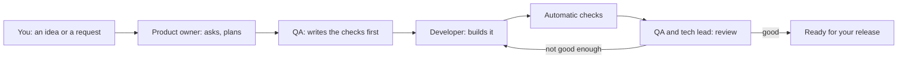

# Agentic Software Factory (ASF)

**Describe the app you want. A small team of AI agents builds it, tests it, and asks you only the decisions that are
yours to make.**

> Status: 0.1, experimental. It works end to end, but it is new: expect rough edges, and keep an eye on what it
> builds. Not yet on npm.

## The idea, in plain words

Think of ASF as hiring a small software agency, except the agency is a team of AI agents that works on your own
computer.

- **You are the owner.** You explain what you want, answer questions about it, and decide when it goes live.
- **The team does the rest.** It plans the work, writes the code, writes tests that prove the code works, reviews
  itself, and fixes what fails.
- **It only stops for you when it has to.** A question about what the product should do, something that costs
  money, something that cannot be undone, or the moment to release. Technical choices are the team's.

It uses the AI subscription you already have (Claude, or ChatGPT through Codex). There is no ASF account, no server
of ours, and your code stays on your machine.

## Who is on the team

| Role | In everyday words |
| --- | --- |
| **Product owner** | Talks the idea through with you, looks at what similar products already exist, and turns it all into a plan of small pieces of work. Asks you when something is unclear. |
| **QA** (quality) | Before anything is built, writes the checks that will prove it works. Afterwards, decides whether it really does what you asked. |
| **Developer** | Writes the code, one piece at a time. |
| **Tech lead** | The senior developer: plans the risky pieces and reviews every change before it is accepted. |
| **Security reviewer**, **UX designer** | Specialists you switch on when the product needs them: security for anything with money, passwords or personal data; UX for anything people click on. The product owner tells you when. |
| **DevOps engineer** | Sets up how the product is put online. You press the button. |
| **Scrum master** | When something went wrong, works out how to stop it happening again. |

## What you do, and what the team does

| You | The team |
| --- | --- |
| Explain the idea and who it is for | Researches similar products and proposes what to build first |
| Answer questions about what the product should do | Turns your answers into a plan with clear "done" conditions |
| Decide on costs (a paid service) and anything that cannot be undone | Picks the technology, writes the code and the tests |
| Say yes to a release and to putting it online | Reviews and fixes its own work, and learns from its mistakes |

## How one piece of work goes



**An example.** Say you want a website where people can check whether they qualify for a housing programme.

1. In a conversation, the product owner asks who the users are and what they use today, looks at similar sites, and
   proposes a first version: an eligibility check and a list of open projects.
2. It splits that into small pieces, such as "the eligibility questions" or "the list of projects by city", each with
   conditions that say when it is done.
3. The team builds the pieces one by one while you do something else. If it needs to know something ("should the
   check save people's answers?"), it asks, with options and a recommendation.
4. You look at the board, answer, and when a batch is ready you release it.

## Before you start

You need:

- A Mac or a Linux computer.
- A **Claude** subscription (Pro or Max) or a **ChatGPT** subscription that includes Codex.
- About 15 minutes of help from someone technical, once, to install it. They can follow [Install](#install) below.

## Getting started

Open the Terminal app and type the commands below. Each one prints what it did and what to do next.

**1. Create a project** (`my-idea` is any name you like):

```bash
asf init my-idea
```

```bash
cd my-idea
```

**2. Talk the idea through.** This opens a conversation with the product owner. Answer in your own words; when you
are not sure, say "decide for me".

```bash
asf discover
```

**3. Let the team work.** Leave this window open; it keeps working, and your computer shows a notification when a
piece of work stops and needs you. Press Ctrl-C to stop it; it picks up where it was next time.

```bash
asf run --watch
```

**4. Check in, any time, in a second window.** The board shows what each piece of work is doing and, under
"Waiting for you", every decision the team needs, with the exact command to give it.

```bash
asf
```

**5. Give a decision.** The board tells you which one. For example, to see a question and then answer it:

```bash
asf show B-0003
```

```bash
asf decide B-0003 Q1 "Only Hanoi and Ho Chi Minh City for now"
```

Or take every recommendation the product owner made: `asf decide B-0003 accept`. To send a piece of work back with a
reason: `asf decide B-0003 reject "the button text should be in Vietnamese"`.

**6. Release and go live** when the board says a batch is ready:

```bash
asf release
```

```bash
asf deploy production
```

`asf deploy` first only shows what it would do. Add `--yes` to really do it.

## Questions people ask

**Do I need to know how to program?** Not for everyday use: you talk, answer and decide. Someone technical helps
with the first install, and with setting up where the product goes online.

**How much does it cost?** Nothing beyond your AI subscription. Building uses its allowance; when you hit the
limit, the team pauses and carries on when the allowance comes back. The board shows how much it used today.

**Is it safe?** The agents work in a locked-down space: they cannot see your passwords or keys, cannot reach the
internet beyond downloading code libraries, and cannot put anything online. Only you release and deploy.

**What if the team gets something wrong?** Send it back with `asf decide <id> reject "<what is wrong>"`; the reason
becomes the team's instructions. Every piece has to pass the checks written before it was built, and a mistake that
repeats becomes a new automatic check.

**Can I use Jira instead of the terminal?** Yes. The team takes requests from your Jira tickets, posts its questions
there, and you answer in comments. Someone technical sets it up once.

**What can it not do yet?** It is version 0.1. Some of its judgement calls (how big a piece of work is, when to ask
you, how good the market research is) are not measured yet, and it does not yet watch the product once it is live.

## Words you will see

| Word | Meaning |
| --- | --- |
| **Backlog item** (`B-0003`) | One small piece of work, such as one feature or one fix |
| **Acceptance criteria** (`AC-001`) | The conditions that say when a piece of work is done |
| **Checks**, **tests** | Small programs that prove the code does what it should, run automatically |
| **Branch**, **merge** | A separate copy where work happens; merging puts it into the main version |
| **Release** | Accepting a batch of finished work into the main version of the product |
| **Deploy** | Putting the product online for real users |
| **Lesson** (`L-1`) | A rule the team adds after a mistake, so it does not happen again |

---

## For technical readers

### Install

Node.js 22+, git, Claude Code and/or Codex signed in, and the sandbox runtime
(`npm install -g @anthropic-ai/sandbox-runtime`; on Linux also `bubblewrap` and `socat`).

```bash
git clone https://github.com/Tech-Expansion/agentic-software-factory.git
```

```bash
cd agentic-software-factory && npm install && npm run build && npm link
```

Then, in a new product's `.factory/project.yaml`: set `integration_branch: integration`, so items that pass merge on
their own and the owner releases them in batches, and set `commands.check` (lint, build, test) once the stack is
known; `asf validate` checks the settings.

### How it works

- Each item runs a workflow: QA writes acceptance tests from the criteria and they are locked; the developer builds
  in its own git worktree; the product's checks run; QA judges the criteria; the tech lead reviews the code;
  specialists review if turned on. A failure goes back to the developer with the reason, up to a limit.
- A small item skips the tests written first; one that touches a sensitive path is built again with them.
- What waits for the owner: the product owner's blocking questions, changes to `owner_paths` (migrations by
  default), decisions a reviewer escalates, high-risk plans that need the owner, releases and deploys
  ([ADR 0012](docs/adr/0012-the-client-decides-the-tech-lead-reviews.md)).
- The runner drives the official CLIs as subprocesses and never touches a credential
  ([ADR 0001](docs/adr/0001-run-inside-the-users-own-agent-cli.md)). Agent commands and checks run sandboxed, with
  network only to package registries ([ADR 0004](docs/adr/0004-sandbox-agent-commands-and-checks.md)). Policy is
  code: protected paths are put back, denied commands refused, budgets enforced, and a product can only tighten the
  defaults.
- Tokens are a design metric: each step gets only its role, its skills and its item's artifacts, cheap checks run
  before any model review, and every step logs what it used.

### Commands

| Command | What it does |
| --- | --- |
| `asf [--json]`, `asf --date <day>` | The board, or the report of one day |
| `asf decide <id> …` | `approve`, `reject <reason>`, `retry`, `Q1 <answer>`, `accept`; `accept` or `reject` a lesson `L-n` |
| `asf show <id>` | An item's open questions, its branch and why it stopped; or a lesson |
| `asf run [--item id] [--all] [--watch]` | Build now, or keep working unattended (`--workers n`, `--interval s`, `--once`) |
| `asf init`, `asf discover`, `asf validate` | Set up and plan a product |
| `asf release [--dry]`, `asf deploy <env> [--yes]` | Merge the integration branch; run the deploy commands with the owner's credentials |
| `asf clarify`, `asf sync` | One round of what `--watch` does: clarify new items; sync with Jira ([ADR 0005](docs/adr/0005-tracker-through-acli-decisions-by-owner-comments.md)) |
| `asf eval` | Measure the factory on its eval cases (factory development) |

### Make it yours

A product repository holds `product/`, `specs/`, `backlog/`, `docs/`, its code and one `.factory/` folder; delete
`.factory/` and it is an ordinary repository. Without changing the factory
([ADR 0009](docs/adr/0009-product-overrides-and-the-quick-workflow.md)):

- `.factory/agents/<role>.md` and `.factory/skills/<name>/SKILL.md` add product rules to a role or a skill.
- `.factory/workflows/<name>.yaml` replaces a workflow or adds one; `workflow:` picks the default, per item or per
  ticket label `asf-<name>`.
- `specialists:`, `paths:`, `models:`, `runtimes.roles:` and `deploy:` in `project.yaml`; `owner_paths`,
  `sensitive_paths` and the network allowlist in `.factory/policy.yaml`.

### Known limits

- The sandbox is not a container. Codex has no network but can read what its user can; the secret scan before each
  commit is the backstop there.
- Codex enforces access through its sandbox only; the denied commands and the checks inside the developer's session
  ([ADR 0008](docs/adr/0008-checks-inside-the-builders-session.md)) apply to Claude Code.
- The size call, the tech lead's escalations and the market scan are a model's judgement, not yet measured.
  Unattended agents have no web access.
- SRE is designed, not built. Jira is the only tracker, not yet checked against the real `acli`.

### Development

`npm test` uses a fake runtime and spends no tokens. `asf eval` builds the cases in `evals/cases/` against hidden
tests with your CLI (`--trials k` for pass^k); `asf eval --reference` checks the cases with their own solutions, as CI
does. What is measured and what is next: the [roadmap](docs/roadmap.md). Rules for changing this repository:
[AGENTS.md](AGENTS.md).

## License

[MIT](LICENSE)
