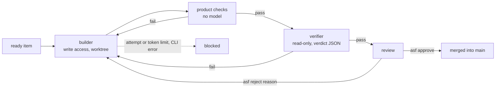

# agentic-software-factory

A local-first agentic software factory: a small team of AI agents that turns a rough idea into tested, documented
software, using your own Claude Code or Codex subscription.

You plan with the **planner** in an interactive session. After that, `asf run` builds the backlog unattended: the
**builder** implements one item in its own git worktree, your product's own checks run, and a read-only **verifier**
judges the result against the item's acceptance criteria. Nothing reaches your main branch until you run
`asf approve`.

> Status: 0.1, experimental. The first vertical slice works end to end with Claude Code 2.1 and codex-cli 0.147.
> Not yet published to npm.

## Why it is built this way

- **Your subscription, your machine.** The factory drives the official CLIs you are already signed in to, as
  subprocesses. It never touches a token or a credential file, and nothing runs on someone else's server.
  See [ADR 0001](docs/adr/0001-run-inside-the-users-own-agent-cli.md).
- **Spec-driven.** Brief → specs with numbered acceptance criteria → backlog items that name the criteria → tests
  named after the criteria → a verdict per criterion.
- **Tokens are a design metric.** Each step gets only its role, the skills it needs and the artifacts of its item.
  Cheap checks (lint, build, tests) run before any model review, and every step logs what it used.
- **The policy is data, not a prompt.** Protected paths are put back, denied commands are refused by the CLI, attempt
  and token limits stop runaway loops, and a product can only tighten the defaults.

## How a backlog item flows



## Requirements

- Node.js 22 or later, and git.
- Claude Code and/or Codex installed and signed in. A different vendor as verifier is recommended.

## Install from source

```bash
git clone https://github.com/Tech-Expansion/agentic-software-factory.git
```

```bash
cd agentic-software-factory && npm install && npm run build && npm link
```

## Quick start

```bash
asf init my-idea && cd my-idea
```

1. Edit `.factory/project.yaml`. Above all, set `commands.check` once the stack is known: it is the cheapest gate.
2. `asf discover`: the planner interviews you and writes `product/brief.md`, `specs/` and `backlog/`. It sets items to
   `ready` only when you agree.
3. `asf validate`: settings, policy and the links between backlog, specs and criteria.
4. `asf run` builds the next ready item, `asf run --all` keeps going until one blocks or none is left.
5. `asf report`, `asf show <id>`, then `asf approve <id>` or `asf reject <id> "<reason>"`.

## Commands

| Command | What it does |
| --- | --- |
| `asf init [dir] [--name n]` | Create a product skeleton, `git init` it and register it in `~/.agentic-software-factory` |
| `asf discover` | Interactive planning session with the planner, in your CLI |
| `asf validate` | Check `.factory/`, the backlog and its spec and criterion links |
| `asf run [--item id] [--all]` | Build ready items unattended |
| `asf show <id>` | Branch, worktree, why it stopped, what needs your attention |
| `asf approve <id>` | Mark the item done and merge its branch (the only way code reaches the base branch) |
| `asf reject <id> <reason>` | Send it back; the reason becomes the builder's feedback |
| `asf retry <id>` | Let a blocked item run again |
| `asf report [--date d]` | Daily report: done, waiting for you, blocked, next, tokens per step |
| `asf projects` | Products registered on this machine |

## Repository layout

| Path | What it is |
| --- | --- |
| `agents/` | Role briefs: planner, builder, verifier |
| `skills/` | Skills the steps load, one folder each |
| `workflows/` | Steps per kind of work (`feature.yaml`) |
| `policies/default.yaml` | What agents may not do, limits, paths that need your attention |
| `templates/product/` | What `asf init` creates |
| `schemas/` | JSON Schema for `project.yaml`, `policy.yaml`, backlog items, verdicts and run events |
| `src/` | The runner (`asf`) and the runtime adapters |
| `docs/adr/` | Design decisions |

A product repository holds `product/`, `specs/`, `backlog/`, `docs/`, its code, and one `.factory/` folder. Delete
`.factory/` and it is an ordinary repository. See [ADR 0002](docs/adr/0002-repository-layout.md).

## Known limits

- No container isolation yet: a builder can reach whatever its CLI's sandbox allows. Do not run ideas you do not
  trust. See [ADR 0003](docs/adr/0003-runner.md).
- Codex enforces access through its sandbox only; the denied-commands list applies to Claude Code.
- Only the feature workflow exists. Learning from the run log, deployment and external trackers are not built yet.
- A builder call carries a fixed overhead of about 30k input tokens per turn (the CLI's own system prompt and tools),
  most of it served from cache.

## Development

```bash
npm test
```

Tests use a fake runtime and spend no tokens.

## License

[MIT](LICENSE)
