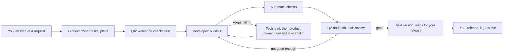

# The owner's guide

For the person who owns a product the factory builds. No programming needed. To set it up, start with the
[README](../README.md); how it works inside is in [ARCHITECTURE.md](../ARCHITECTURE.md).

## Who is on the team

| Role | In everyday words |
| --- | --- |
| **Product owner** | Talks the idea through with you, looks at what similar products already exist, and turns it all into a plan of small pieces of work. Asks you when something is unclear, in everyday words. |
| **QA** (quality) | Before anything is built, writes the checks that will prove it works. Afterwards, decides whether it really does what you asked. |
| **Developer** | Writes the code, one piece at a time. |
| **Tech lead** | The senior developer: chooses the technology, plans the risky pieces, reviews every change before it is accepted, and works out why a piece keeps failing before anyone asks you. |
| **Security reviewer**, **UX designer** | Specialists you switch on when the product needs them: security for anything with money, passwords or personal data; UX for anything people click on. The product owner tells you when. |
| **DevOps engineer** | Sets up how the product is put online: the test version updates itself, the real one when you release. |
| **Scrum master** | When something went wrong, works out how to stop it happening again. |

## What you do, and what the team does

| You | The team |
| --- | --- |
| Explain the idea and who it is for | Researches similar products and proposes what to build first |
| Answer questions about what the product should do | Turns your answers into a plan with clear "done" conditions |
| Decide on costs (a paid service) and anything that cannot be undone | Picks the technology, writes the code and the tests |
| Say when a batch goes live | Reviews and fixes its own work, keeps the test version up to date, and learns from its mistakes |

## How one piece of work goes

**An example.** Say you want a website where people can check whether they qualify for a housing programme.

1. In a conversation, the product owner asks who the users are and what they use today, looks at similar sites, and
   proposes a first version: an eligibility check and a list of open projects.
2. It splits that into small pieces, such as "the eligibility questions" or "the list of projects by city", each with
   conditions that say when it is done.
3. The team builds the pieces one by one while you do something else. If it needs to know something ("should the
   check save people's answers?"), it asks, with options and a recommendation.
4. Each finished piece shows up in the test version. You try it, answer what the team asks, and when you are happy
   with a batch you release it.

## Giving a decision

The board (`asf`) lists every decision the team needs under "Waiting for you", with the exact command that gives it.

| The team needs | You type |
| --- | --- |
| An answer to a question | `asf show B-0003`, then `asf decide B-0003 Q1 "Only Hanoi and Ho Chi Minh City for now"` |
| Your yes to every recommendation | `asf decide B-0003 accept` |
| What to do instead, when it could not build a piece as asked | `asf decide B-0003 retry "<your answer>"` |
| Your yes to something that costs money or cannot be undone | `asf decide B-0003 approve`, or `asf decide B-0003 reject "<why>"` |

## Going live

`asf release` puts what is on the test version live. On GitHub it opens a release request listing what is in it; you
merge it there, and the product goes live. Without GitHub, `asf release` puts the batch live at once. If your product
is put online by a command instead, `asf deploy production` shows what it would do, and `--yes` does it.

## Questions people ask

**Do I need to know how to program?** Not for everyday use: you talk, answer and decide. Someone technical helps
with the first install, and with setting up where the product goes online.

**How much does it cost?** Nothing beyond your AI subscription. Building uses its allowance; when you hit the
limit, the team pauses and carries on when the allowance comes back. The board shows how much it used today.

**Is it safe?** Each piece is built in its own copy of your code, the test version updates on its own, and only you
put a release live. A change to how the product is put online waits for your yes, and anything that looks like a
password or key is never saved into the code. By default the commands an agent runs can reach what you can reach on
your computer, like any coding agent you run yourself. For a product with keys, money or personal data, ask someone
technical to [turn on the sandbox](../ARCHITECTURE.md#the-sandbox): the agents then work in a locked-down space
where they cannot see your passwords or reach the internet beyond downloading code libraries.

**What if the team gets something wrong?** You see it on the test version before anyone else does. Ask for the
change like any other request; it goes out with the next release. Every piece has to pass the checks written before
it was built, a piece that keeps failing goes to the tech lead and the product owner before it comes to you, and a
mistake that repeats becomes a new automatic check.

**Can I use Jira instead of the terminal?** Yes. The team takes requests from your Jira tickets, posts its questions
there, and you answer in comments. Someone technical sets it up once.

**What can it not do yet?** It is version 0.1. Some of its judgement calls (how big a piece of work is, when to ask
you, how good the market research is) are not measured yet, and it does not yet watch the product once it is live.

## Words you will see

| Word | Meaning |
| --- | --- |
| **Backlog item** (`B-0003`) | One small piece of work, such as one feature or one fix |
| **Acceptance criteria** (`AC-001`) | The conditions that say when a piece of work is done |
| **Checks**, **tests** | Small programs that prove the code does what it should, run automatically |
| **Branch**, **merge** | A separate copy where work happens; merging puts it into the main version |
| **main**, **production** | The team's version, which the test version shows, and the live one, which only you change |
| **Release** | Putting a batch of finished work live: from main into production |
| **Deploy** | Putting a version of the product online: the test one on its own, the real one when you release |
| **Lesson** (`L-1`) | A rule the team adds after a mistake, so it does not happen again |
